# Shortlist: AI-Assisted Recruitment Platform

Shortlist is a recruitment system that takes a job from a pasted job description to a shortlist of applicants. Recruiters publish jobs and review applicants. Applicants apply through a public page. Each CV is screened automatically against the job's weighted skills, and shortlisted applicants can book an interview.

The system has a React frontend, a Node.js layer, and n8n as the workflow engine. Google Sheets stores the data, Google Drive stores the CVs, and Gmail and Google Calendar handle email and interviews.

> **Demo video:** [Watch the walkthrough](#) *(replace `#` with the video link)*

---

## Table of contents

1. [Features](#features)
2. [Architecture](#architecture)
3. [Technology stack](#technology-stack)
4. [Repository structure](#repository-structure)
5. [Prerequisites](#prerequisites)
6. [Installation](#installation)
7. [Configuration](#configuration)
8. [Workflow reference](#workflow-reference)
9. [Data model](#data-model)
10. [Scoring](#scoring)
11. [Security and privacy](#security-and-privacy)
12. [Testing](#testing)
13. [Known limitations](#known-limitations)

---

## Features

**Recruiters**
- Create a job by pasting its description. The AI extracts the required and nice-to-have skills, with weights taken from the description when they are stated, or suggested otherwise.
- Review and edit the skills and weights before the job is published.
- Publish the job to Telegram and LinkedIn.
- See all of their jobs, grouped into open and closed, and close a job.
- See the applicants for each job, grouped by stage, with the score, the CV, and the interview details.
- Move a manual-review applicant to pending review, and accept an applicant.

**Applicants**
- Browse open positions and read a formatted job post.
- Apply with a PDF CV. Every field and the file are checked on the server.
- Receive a reference number and a confirmation email.
- Receive an invitation to choose an interview time, and book it on a page that shows real availability.
- See a skills-in-demand dashboard for all open positions.

**Platform**
- Every skill counts only when the CV contains a quote that supports it. The code checks each quote against the CV text.
- Hidden instructions inside a CV are detected and sent to manual review.
- Names, emails, phone numbers and links are removed from the CV before the AI reads it.
- A second application to the same job is blocked. Applying to a different job is allowed.
- A technical failure never rejects an applicant. The application goes to manual review.

---

## Architecture

```
 Recruiter browser ──► Recruiter pages (n8n webhooks) ───┐
                                                         │
 Applicant browser ──► Applicant pages (n8n webhooks) ───┤
                                                         │
                                                         ▼
                                          ┌──────────────────────────────┐
                                          │  n8n workflows (12)          │
                                          │  pages, validation, logic    │
                                          └──┬──────────┬──────────┬─────┘
                                             │          │          │
                                  ┌──────────┘          │          └─────────┐
                                  ▼                     ▼                    ▼
                        Google Sheets             Google Drive         Gmail / Calendar
                          (data)                     (CVs)           (email, interviews)
                                                        │
                                                        ▼
                                            OpenRouter (AI models)
                                            skills, post text, CV evidence
                                                        │
                                                        ▼
                                          Telegram / LinkedIn (publishing)
```

### Design principles

- **Save first.** The application is stored before any AI work runs, so a failure does not lose it.
- **The AI finds evidence, the code does the maths.** The model names the skills it sees and quotes them. The code verifies the quotes and computes the score.
- **Nothing goes live without review.** A job is published only after the recruiter approves its skills.
- **Failures go to people.** A problem that the system cannot resolve is marked for manual review.

---

## Technology stack

| Area | Technology |
|---|---|
| Frontend | React (Vite) |
| Workflow engine and pages | n8n (self-hosted) |
| Data | Google Sheets |
| Files | Google Drive |
| Email and interviews | Gmail, Google Calendar (free/busy, events, Google Meet) |
| AI | OpenRouter |
| Publishing | Telegram Bot API, LinkedIn |
| Public access | HTTPS address for n8n (for example an ngrok domain during development) |

---

## Repository structure

```
shortlist/
├── client/                    # React + Vite frontend
│   ├── src/
│   └── package.json
├── workflows/                 # n8n workflow exports, one file per workflow (see Workflow reference)
├── docs/
│   └── screenshots/           # Screenshots used in this README
└── README.md
```

---

## Prerequisites

- Node.js 20 or later, and npm
- Docker, for running n8n
- A Google Cloud project with the Sheets, Drive, Gmail and Calendar APIs enabled, and OAuth client credentials
- An OpenRouter API key
- A Telegram bot token and the target channel
- A LinkedIn developer app, if you publish to LinkedIn
- A public HTTPS address for n8n, because webhooks and Google sign-in need one

---

## Installation

### 1. Clone the repository

```bash
git clone https://github.com/<your-username>/shortlist.git
cd shortlist
```

### 2. Run n8n

Create a `docker-compose.yml`:

```yaml
services:
  n8n:
    image: n8nio/n8n:latest
    ports:
      - "5678:5678"
    environment:
      - WEBHOOK_URL=https://<your-public-domain>/
      - GENERIC_TIMEZONE=Africa/Cairo
      - TZ=Africa/Cairo
    volumes:
      - ./n8n-data:/home/node/.n8n
```

```bash
docker compose up -d
```

### 3. Create the Google Sheet

Create one spreadsheet with four tabs: **Jobs**, **Job Skills**, **Applicants** and **Recruiters**. Column names are described in [Data model](#data-model). Copy the spreadsheet ID from its URL.

### 4. Set up Google access

1. In Google Cloud Console, enable the Sheets, Drive, Gmail and Calendar APIs.
2. Create an OAuth 2.0 client (type: Web application).
3. Add this redirect URI: `https://<your-public-domain>/rest/oauth2-credential/callback`
4. In n8n, create credentials for Google Sheets, Google Drive, Gmail and Google Calendar, and sign in with each one.

### 5. Import the workflows

In n8n, choose **Import from file** for each file in `workflows/`. Then:

1. Replace the placeholder values listed in [Configuration](#configuration).
2. Reassign credentials where n8n asks.
3. Refresh the column lists in each Google Sheets node.
4. Activate each workflow.

### 6. Run the frontend

```bash
cd client
npm install
npm run dev
```

Open `http://localhost:5173`.

---

## Configuration

| Placeholder | Used in | Replace with |
|---|---|---|
| `YOUR-DOMAIN` | Job creation, job review, intake, scoring, invitation, scheduling | Your public n8n address, with no trailing slash |
| Spreadsheet ID | Every Google Sheets node | Your spreadsheet |
| Tab IDs (`gid`) | Every Google Sheets node | The numeric ID of each tab |
| Drive folder ID | CV upload and download | The folder that stores CVs |
| Telegram chat ID | Publishing | Your channel or group |
| Company and team names | Email templates | Your branding |
| Recruiter email | Manual-review alert | Address that receives alerts |
| Scoring secret | Intake and scoring | A long random string, shared by the two workflows |
| Apply page address | Job posts | Your public apply page |

Keep real values out of the repository. Store secrets in n8n credentials, and remove them from workflow exports before you commit.

---

## Workflow reference

The system has twelve workflows, in four groups.

### Recruiter workflows

#### 1. Job Creation (`01-job-creation`)

Creates a draft job from a recruiter's description.

- **Endpoints:** GET `/job-new` serves the form. POST `/job-create` receives it.
- **Steps:** validate the input, ask the AI for skills, weights, experience and education, normalize the output, write the post text for each platform, run a leak check so no weights appear in public text, and save a draft.
- **Output:** a draft job in the Jobs tab, and a link to the review page.
- **On failure:** invalid input returns the problems on the form. A failed extraction returns a message and saves nothing.

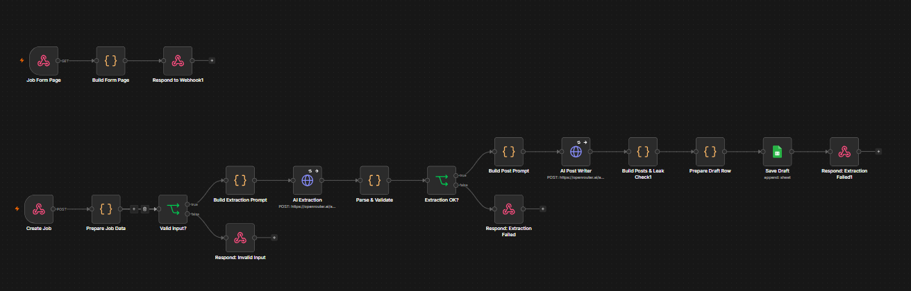

#### 2. Job Review and Approval (`02-job-review-approval`)

The recruiter confirms the skills and weights before the job goes live.

- **Endpoints:** GET `/job-review` serves the review page. POST `/job-approve` saves the approval.
- **Steps:** check the review token, validate the skills (weights 1 to 10, at least two required skills), re-run the leak check on the edited posts, save the skills, open the job, and publish to Telegram and LinkedIn.
- **Output:** an open job, and a confirmation page with the apply link.
- **Security:** the review token is cleared on approval, so the link can't be used again.

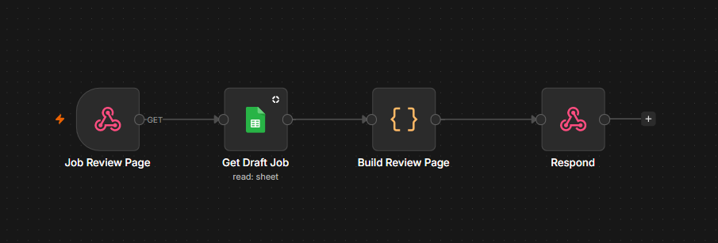

#### 3. Recruiter Jobs Page (`03-recruiter-jobs`)

The recruiter's home page.

- **Endpoints:** GET `/recruiter?recruiter-name=...` serves the page. POST `/close-job` closes a job.
- **Steps:** load the jobs for the named recruiter, separate them into open and closed, and show them. Closing a job sets its status to `Closed` in the sheet.

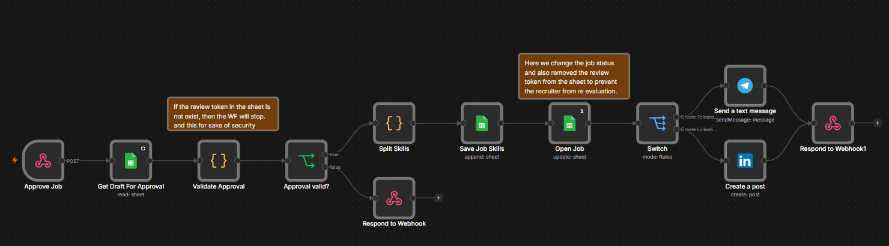

#### 4. Job Applicants Page (`04-job-applicants`)

The applicant list for one job.

- **Endpoint:** GET `/job?jobId=...`
- **Output:** applicants grouped into pending review, manual review, accepted, and auto-rejected, with the score, interview date and link, the CV link, and the action for each applicant.
- **Actions:** **Accept** sends the applicant to the Accept workflow. **Move to pending** sends a manual-review applicant to the Applicant To Pending workflow.

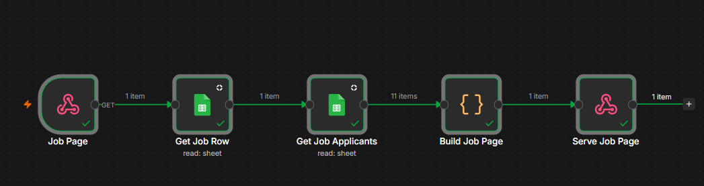

#### 5. Accept and Move to Pending (`05-accept-and-move-to-pending`)

Two actions that the applicant list uses.

- **Accept:** POST `/accept-applicant`. Checks that the applicant can be accepted, sets the status to `Accepted`, and sends a congratulations email. The email is sent once.
- **Move to pending:** POST `/applicant-to-pending`. Checks that the applicant is in manual review and belongs to the job, sets the status to `Pending Review`, and sends the interview invitation.

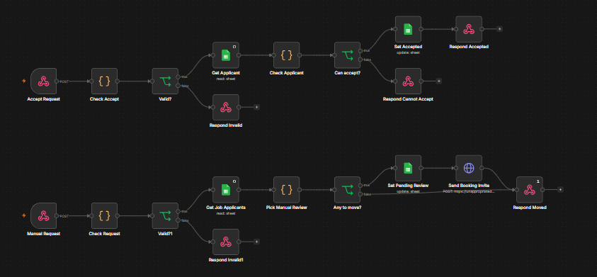

### Applicant workflows

#### 6. Open Positions and Job Post (`06-open-positions`)

Public job pages.

- **Endpoints:**
  - GET `/jobs` lists open positions.
  - GET `/post?jobId=...` shows one job post, with responsibilities, requirements, nice-to-have skills, and an apply button.
- **Closed jobs:** the post shows an unavailable message.

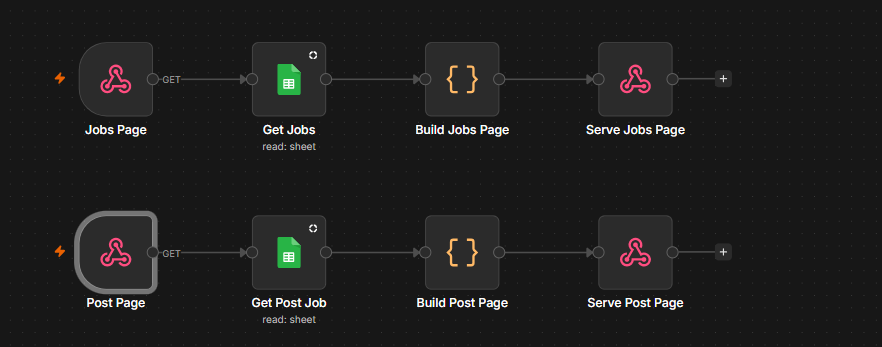


#### 7. Skills in Demand (`07-skills-dashboard`)

- **Endpoint:** GET `/skills`
- **Output:** charts of the skills requested by open positions, split into required and nice-to-have. It also shows average experience by role, positions posted per week, and a table by role.
- **Privacy:** weights and thresholds are never shown.

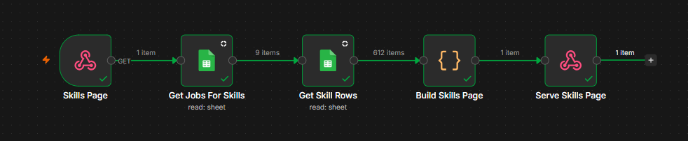

#### 8. Application Intake (`08-application-intake`)

The application form.

- **Endpoints:** GET `/apply?jobId=...` serves the form. POST `/apply-submit` receives it.
- **Steps:** validate all fields and the PDF on the server, confirm the job is open, check for an earlier application to the same job, save the CV in Drive, write the applicant row with status `Recieved`, start scoring, and send the confirmation email.
- **Output:** a reference number on the page, and a confirmation email.

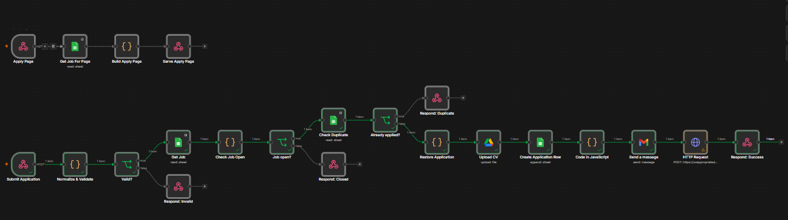

### Processing workflows

#### 9. CV Scoring (`09-cv-scoring`)

Scores an application in the background.

- **Endpoint:** POST `/score-application`, which requires the shared secret.
- **Steps:**
  1. Check that the row exists and its status is `Recieved`. This prevents double scoring.
  2. Set the status to `Scoring`.
  3. Download the CV and extract its text.
  4. Treat a near-empty or unreadable CV as a technical problem.
  5. Scan for instructions aimed at the AI.
  6. Remove personal details from the text.
  7. Ask the AI which skills the CV shows, with a quote for each.
  8. Check each quote against the CV, and count only the verified skills.
  9. Compute the score in code.
  10. Save the result and send the matching email. Passing candidates also receive an interview invitation.
- **Output:** status `Pending Review`, `Auto-Rejected`, or `Needs Manual Review`.

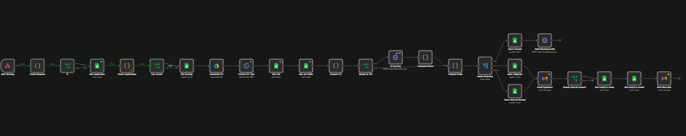

#### 10. Interview Invitation (`10-interview-invitation`)

Sends an applicant a link to choose an interview time.

- **Trigger:** called by CV Scoring after a pass, and by Applicant To Pending.
- **Steps:** load the applicant, job and recruiter, create a random scheduling token, save it, and send the email.
- **Protection:** an applicant who already has an invitation or an interview does not get another.

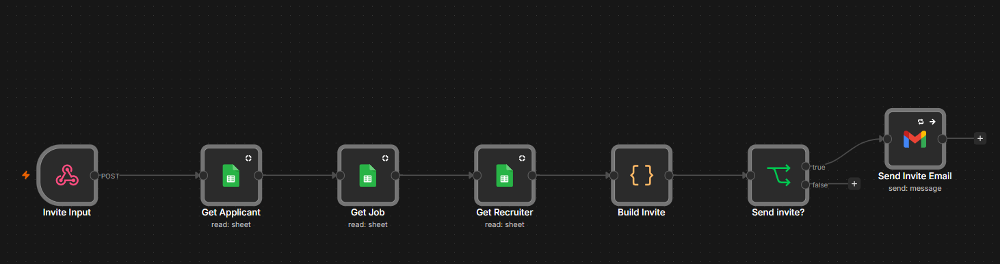

### Scheduling workflows

#### 11. Schedule Page (`11-schedule-page`)

- **Endpoint:** GET `/schedule?applicationId=...&token=...`
- **Steps:** check the link and token, request the calendar's busy periods, and show the free 30-minute slots. Slots run from Sunday to Thursday, with start times from 10:00 to 15:30, Cairo time, for the next eight days.
- **Output:** the slots grouped by day. After a booking, the page shows the confirmed time and meeting link.

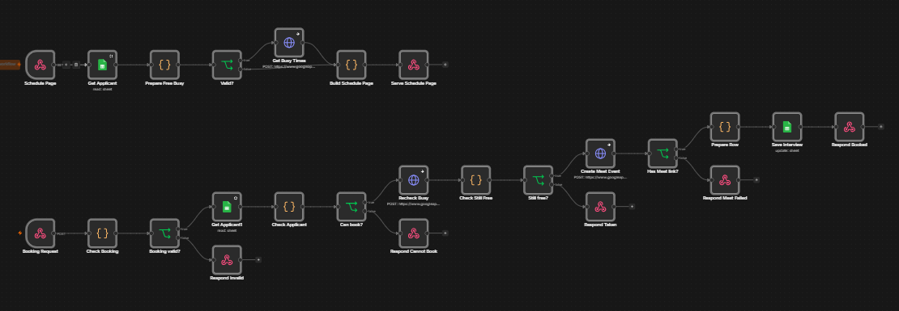

#### 12. Schedule Booking (`12-schedule-booking`)

- **Endpoint:** POST `/schedule-book`
- **Steps:** check that the slot is at least an hour ahead, within the booking window, and on a 30-minute boundary. Verify the token and status. Check the calendar again. Create the event with a Google Meet link, invite the applicant, and save the time and link.
- **Output:** status `Interview Scheduled`, with the interview date and meeting link saved.


---

## Data model

The Google Sheet is the system of record.

### Jobs

| Column | Description |
|---|---|
| `jobId` | `JOB-YYYYMMDD-XXXX` |
| `role` | Job title |
| `status` | `Draft`, `Open` or `Closed` |
| `createdAt` | Creation time |
| `platforms` | Selected platforms |
| `minExperienceYears` | Minimum experience |
| `education` | Education requirement |
| `webPost` | Job page content, stored as JSON |
| `telegramPost`, `linkedinPost` | Publishing text |
| `applyLink` | Public application link |
| `rawJD` | Job description as pasted |
| `draftSkills` | Skills awaiting approval |
| `reviewToken` | One-time review token, cleared on approval |
| `approvedAt` | Approval time |
| `recruiterName` | Recruiter responsible for the job |

### Job Skills

| Column | Description |
|---|---|
| `jobId` | Job the skill belongs to |
| `skill` | Skill name |
| `weight` | Integer from 1 to 10. Private, never shown to applicants |
| `type` | `Required` or `Nice-to-have` |

### Applicants

| Column | Description |
|---|---|
| `applicantName`, `applicantEmail`, `applicantPhone` | Applicant details |
| `appliedPosition` | Job title applied for |
| `applicationId` | `APP-YYYYMMDD-XXXXX` reference |
| `jobId` | Job applied for |
| `yearsExperienceClaimed` | Years the applicant stated |
| `cvFileId`, `cvLink` | Stored CV |
| `dupKeyEmail`, `dupKeyPhone` | Keys for duplicate detection (job ID plus email or phone) |
| `consentAt` | Time of consent |
| `scoreBreakdown` | Score components, stored as JSON |
| `evidence` | Verified skills with their quotes, stored as JSON |
| `status` | Current stage (see below) |
| `interviewDate`, `interviewScore`, `meetingLink` | Interview details |
| `extractedSkills` | Verified skills |
| `experienceYearsActual` | Years found in the CV |
| `educationDetected` | Education found in the CV |
| `finalScore` | Score out of 100 |
| `fitSummary` | Short neutral summary |

**Status values in use:** `Recieved`, `Scoring`, `Pending Review`, `Needs Manual Review`, `Auto-Rejected`, `Interview Scheduled`, `Accepted`.

> **Note:** `Recieved` is spelled this way in the workflows. If you correct the spelling, change it in the Intake and CV Scoring workflows too.

**Note on the header:** the workflows also write the following values. They are not in the current header, so n8n can't save them until the columns exist:

- `applicationDate`: intake time
- `flags`: reason for manual review
- `scheduleToken`: token that secures the scheduling link
- `bookingInviteSentAt`: prevents duplicate invitations
- `acceptedEmailSentAt`: prevents duplicate acceptance emails

### Recruiters

| Column | Description |
|---|---|
| `recruiterName` | Matches `Jobs.recruiterName` |
| `recruiterEmail` | Reply-to address and alerts |

---

## Scoring

Each application is scored out of 100:

| Part | Weight | Rule |
|---|---|---|
| Required skills | 60 | Share of required-skill weight verified in the CV |
| Experience | 30 | Verified years against the minimum, capped at 100% |
| Education | 10 | Full credit for a match, partial otherwise |
| Nice-to-have skills | Up to 10 bonus points | Share of nice-to-have weight verified |

**Outcomes in the current build:**

| Result | Status |
|---|---|
| Score of 80 or above | `Pending Review` |
| Score below 80 | `Auto-Rejected` |
| Technical problem, hidden instructions, or unreadable CV | `Needs Manual Review` |

The model never sees the weights or the threshold. A skill counts only when its quote is found in the CV.

---

## Security and privacy

- Secrets are held in n8n credentials. The shared scoring secret must be replaced before deployment.
- Every form is validated on the server, and the CV must be a real PDF under 5 MB.
- CV text is cleaned of personal details before the AI reads it.
- Review, scheduling and invitation links use random tokens.
- Applicants see only their own reference number.
- Recruiters see only the jobs they are named on.

**Before production use:** add authentication to the recruiter pages, restrict the public endpoints, and set a data-retention policy for CVs and personal data.

---

## Testing

- The scoring, validation and matching logic was tested with sample data.
- Each workflow was run manually in n8n, and the results were checked in the sheet and in Drive.
- An end-to-end set used ten job descriptions and fourteen sample CVs. It covered a description with stated weights, one without, mixed Arabic and English text, a vague description, a description with an instruction aimed at the AI, scanned and very short CVs, duplicate applications, closed jobs, and invalid links.

---

## Known limitations

- **Google Sheets is the database.** It suits a small team and moderate volume. Production use needs a relational database.
- **Interviews use one calendar.** Each recruiter should connect their own calendar later.
- **Availability is fixed** at Sunday to Thursday, 10:00 to 16:00, Cairo time, and is set inside the workflow.
- **Two applicants can rarely book the same slot.** A second calendar check reduces this, but does not remove it.
- **Scoring uses two outcomes.** The threshold is 80 for every job.
- **Public endpoints have no login.** See [Security and privacy](#security-and-privacy).
- **AI output varies.** Quotes are verified, but the summary is a model output and should be read by a recruiter.